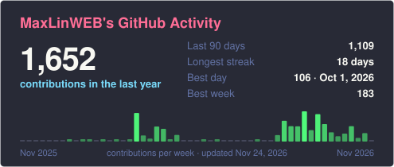

# Marian Maxim

**Full-stack developer. One-man army.** I build whole systems on my own: the scrapers and agents that collect the data, the queues and APIs that move it, the dashboards people use, and the deploy that keeps it running.

Most of that work lives in private repos, so this page is the tour.

## Flagship work

### Leadity: lead-generation SaaS

Customers order Google Maps scrapes and receive phone-validated leads. Multi-tenant, with credit packs, a customer app and an ops dashboard. The backend is a set of independently deployed services sharing one Postgres and one Redis: a FastAPI backend, Playwright scrapers, an email verifier, a phone classifier, an owner enricher and a reviews scraper, with async workers on Redis.

`Python` `FastAPI` `asyncpg` `Redis` `Playwright` `React` `Railway` 
Co-built with a partner. Private repo.

### ONYX: AI outreach agent with a human in the loop

Finds companies in a niche and a city, opens each website in a real browser and turns what it sees into verifiable facts. Then it drafts a short first email built only from those facts. A person approves every send, from the console or a Telegram Mini App. After that it sends from a warmed-up mailbox, follows up, classifies replies, keeps a permanent stop-list and answers interested leads with a full PDF analysis.

`TypeScript` `Next.js 16` `Express 5` `Playwright` `Postgres` `Drizzle` `Redis` `Vitest` 
**160+ commits and 31 merged PRs.** Private repo.

## Also built

- **site-monitor**: an uptime monitor that tells a DNS failure from a TLS error, a 429 or a timeout, ignores one-off blips and pings Telegram only when the status really changes. Includes a `/status` API. `TypeScript` `Node` `Docker` `Railway`
- **Electoniq**: an electronics store for Moldova with catalog, cart, favorites, orders and an admin panel. `React` `Vite` `Tailwind` `Supabase` `Cloudinary`
- **MaxLinify**: a cross-platform music app with an Expo mobile client and a Node backend in Docker. `React Native` `Expo` `Express`
- **ChromeAuto**: a car-parts storefront with tests and an Nginx + Docker deploy. `React` `Vite` `Tailwind 4` `Vitest`
- **Reviews platform**: a review site with photo uploads and admin moderation. `Next.js` `shadcn/ui` `Supabase`
- **AutomatedQA**: a UI test framework with page objects, TestNG, Allure reports and CI. `Java` `Selenium`

## Stack

Only what's actually in my repos.

## How I work

- **Spec before code.** Big projects start with a written contract (`SPEC.md`, `INTERFACES.md`) and the reasons behind each decision.
- **Everything through PRs and CI.** Each change is small and gets its own PR, and tests run in parallel slices.
- **AI agents as a force multiplier.** I build with Claude Code, and a human stays in the approval path wherever real people or real money are involved.
